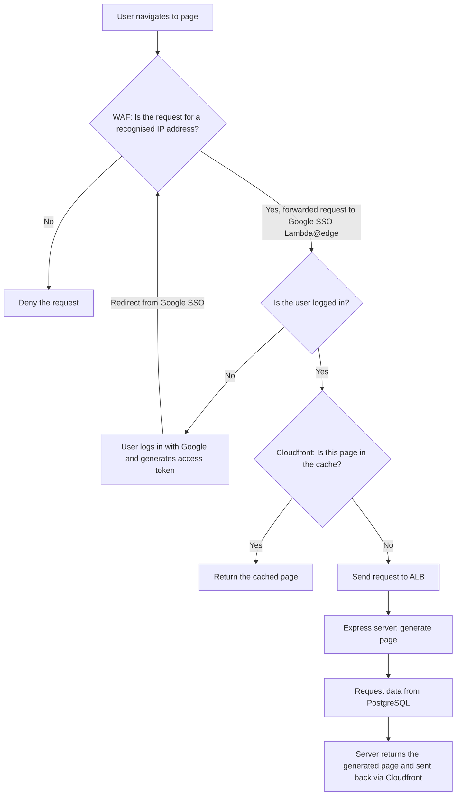
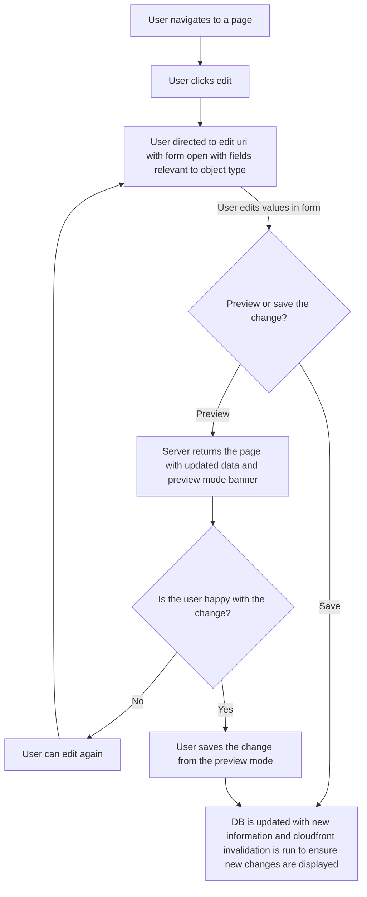

# ADR-FD004: Proposed architecture for GDS Hub re-write MVP

**Status**: Proposed
**Date**: 2026-11-05  
**Authors**: Jacob Bishop-Townsend

---

## ❓ Context

GDS has officially moved off Google and, therefore, The GDS Hub (previously the EE Hub) no longer has a functioning content management system outside of pull requests.
**Google accounts can still be logged in to, but content management via a Google Sheet is no longer possible.**
As the amount of content increased, the build speed and ease of maintenance decreased. The current implementation of the GDS Hub takes ~20 minutes to build in a CI/CD pipeline and isn't fit for purpose any longer.

Because of this, the EE team has decided to re-write and modernise the Hub to ensure it is fit-for-purpose long term.

## 🧩 Decision

- We will implement a new system using the below stack
- This will positively impact how the GDS Hub is interacted with for content editors, viewers will not see substantial changes as part of the MVP.
- This will lay a solid foundation for future enhancements that will improve user experience
- Chosen option: `Node.js, Express.js and Nunjucks` over `Next.js` and `Ruby on Rails`

### Web Application

- Runtime: Node.js
- Language: TypeScript
- Backend framework: Express.js
- Frontend: [GOV.UK Design System using Nunjucks](https://frontend.design-system.service.gov.uk/use-nunjucks/)
- ORM: [Drizzle](https://orm.drizzle.team/docs/get-started)

### Cloud Services

- DNS: Route 53
- CDN: Cloudfront
- Protection: WAF
- Database: PostgreSQL on RDS
- Hosting: [ECS Express Mode](https://docs.aws.amazon.com/AmazonECS/latest/developerguide/express-service-overview.html)
- Uptime monitoring: [Cloudfront alarms](https://docs.aws.amazon.com/AmazonCloudFront/latest/DeveloperGuide/receiving-notifications.html) and [Route 53 Health Checks](https://docs.aws.amazon.com/Route53/latest/DeveloperGuide/health-checks-creating-values.html#health-checks-creating-values-endpoint)
- Environment Secret Store: AWS Secrets Manager
- Authentication: Existing Lambda@edge with Google SSO for MVP, future phase uses an IdP: DSIT Entra tenant preferred, AWS Cognito as backup

### Automated Testing

- Vitest for unit testing
- Playwright for end-to-end

### IaC

- Terraform

## Viewer Flow

## Editor Flow

**Editing will be available to all users in MVP. Future phases will look to implement dedicated, role-based access through an IdP**

## ✅ Status & Acceptance Criteria

### ADR Status gates

- The decision is considered accepted when:
  - [ ] Approved by Engineering Enablement lead technologists
  - [ ] ADR is merged into engineering enablement decision log

### Implementation AC

- This technical decision must consider:
  - [ ] There must be a pre-prod and prod environment
  - [ ] We must use a database instead of content committed to GitHub - this will allow us to keep the repo public and work in the open
  - [ ] Content must be simple to perform CRUD operations on
  - [ ] Content changes must contain an audit log

## 🔍 Alternatives Considered

| Option        | Pros                                                                       | Cons                                                             |
| ------------- | -------------------------------------------------------------------------- | ---------------------------------------------------------------- |
| Next.js       | very fast full stack set up, team familiarity with TypeScript              | No official GOV.UK design system support                         |
| Ruby on Rails | very fast full stack set up, pre-existing prototype, published GOV.UK gems | Team's complete unfamiliarity with RoR will delay rapid delivery |
| Do Nothing    | No effort required                                                         | Long term use of the Hub in jeopardy                             |

## 🧠 Decision Drivers

Key factors influencing this decision:

- GOV.UK Design system already ships with full Nunjucks support ensuring accessibility standards are met
- DevEx team developers all have experience with TS/JS
- Drizzle abstracts away many standard SQL procedures and ensures typing can be leveraged for DB schemas
- Express is lightweight and handles requests and routing easily
- PostgreSQL can use Full Text Search to make search functionality easy and can be updated to include vectorised data if we choose to include AI search/chat functionality
- MVP time requirements necessitate the using of the currently implemented Lambda@edge function
  - SSO via ICS Entra tenant is the preferred option for auth in future phases, but if contact with ICS proves difficult a Cognito user pool managed in the environment is a good alternative that we can control.

## 📈 Consequences

Short- and long-term effects:

- Positive outcomes:
  - Improved reliability/performance
  - Easier content updates
  - Easier maintainability for DevEx team
- Risks:
  - Delivery time-scales to MVP are tight for an entire re-write
  - Changes from current, statically built pages deployed to s3 and served via cloudfront to a running server increase vulnerability footprint

## 📝 Change Log

| Date       | Author                | Change Summary      |
| ---------- | --------------------- | ------------------- |
| 2026-11-05 | Jacob Bishop-Townsend | Created initial ADR |

---
